# EINSTEIN Matchmaker

A team of concurrent [Mozaik](https://github.com/jigjoy-ai/mozaik) agents that finds University of Novi Sad researchers and NTP Novi Sad companies worth an industrial PhD or a joint project together, and writes a concrete, cited proposal for each pair, in the form the researcher agreed to. A Critic agent intercepts every draft. It blocks any claim that the record it cites does not support, and any figure or name in the proposal text that no checked claim backs.

Built for the **EINSTEIN track** of the JigJoy and NTP Novi Sad hackathon (30 to 31 October 2026), on the official synthetic dataset.

- **13 Mozaik participants on one runtime.** Screening, profiling, writing and review overlap. At the peak, 9 jobs ran at once, and in every live batch run all 21 jobs overlapped another agent's work (seven runs).
- **Proposals in the shape of the EINSTEIN example topic.** Each has the company's own numbers, measurable research questions, a plan with a pass or fail target per period, what is new beyond the researcher's own papers, what data exists and what must be collected, a first step, what is still to agree (funding, IP, publication), and a claim-by-claim source list.
- **A Critic that I measured.** It caught 52 of 53 subtle planted errors and wrongly blocked 0 of 72 true claims ([results](docs/evidence/critic-eval-hard/results.md)). Offline guard tests (`npm run test:guards`) cover what a claim check alone misses: facts in the text with no claim, people outside the pair, plans dated in the past, consent, budget and timeouts.
- **Two ways in:** a batch run over 60 company challenges, and **Reverse Search**, where a company types its problem and gets matched researchers.
- **Live demo: [einstein.jamilxt.com](https://einstein.jamilxt.com).** The public site replays every recorded run at no cost. Live search is off there; run it yourself with your own key (below).
- **A web UI** that streams a live search or replays any recorded run: agent lanes, a match map, the Critic's decisions, and proposals with clickable sources.

## Screenshots

**Agents at work.** A replay of live run 1 at 17 s. The lanes are real job start and end times from the trace. The dashed line marks the peak, 9 jobs at once, and the Critic lane shows one draft sent back (red) and one approved (green).

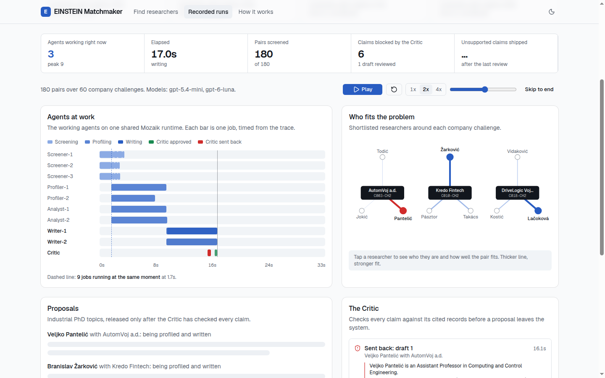

**Proposals and the Critic.** Each proposal is laid out like the EINSTEIN example topic. The Critic feed lists every draft it sent back, the exact claim it blocked, and why.

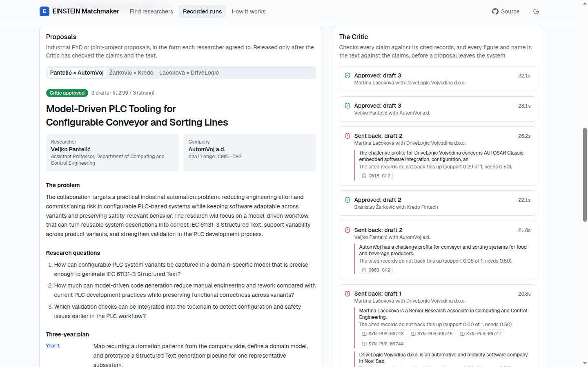

**The final proposal format (run 6).** The collaboration form comes from the researcher's own consent, quoted under the pair. Further down: a plan with a pass or fail target per year, what is new, what data exists, and what is still to agree.

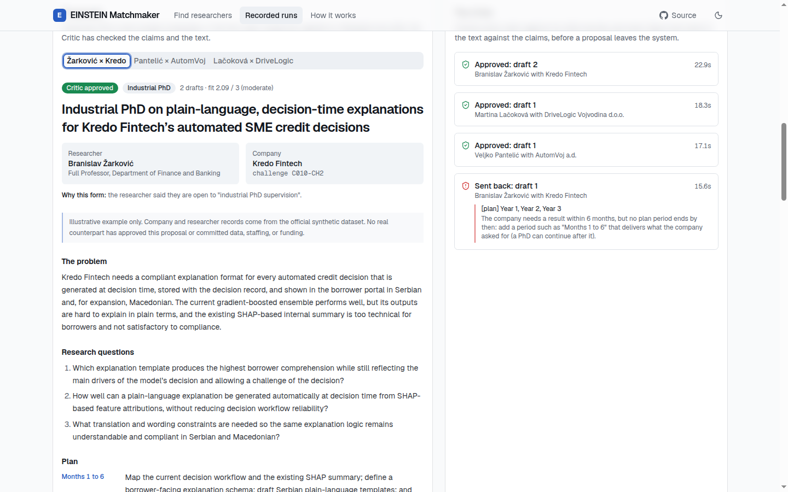

**Every source is one click away.** This is the record exactly as the Critic read it.

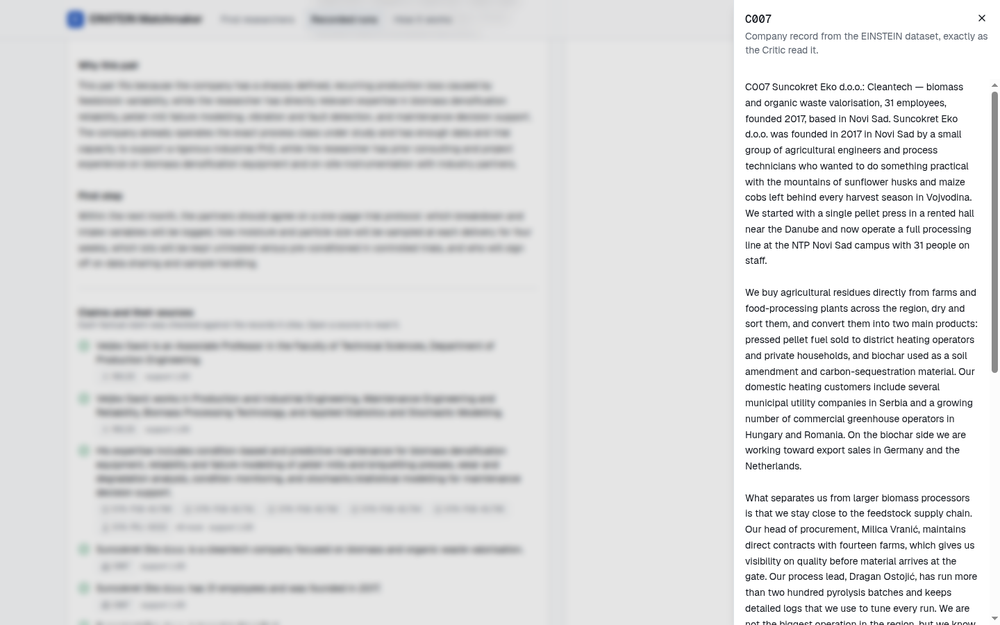

**Reverse Search.** A company describes its problem in its own words.

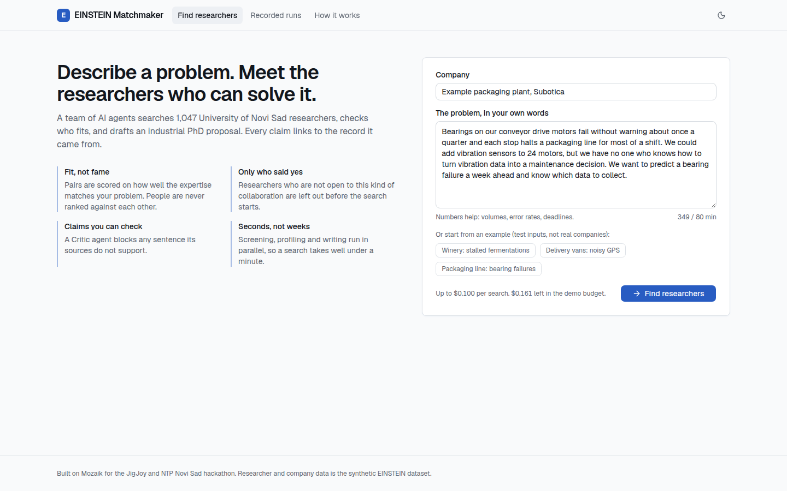

**The same team on one problem.** Fifteen candidates sit around the company's challenge, and the three chosen ones are in bold.

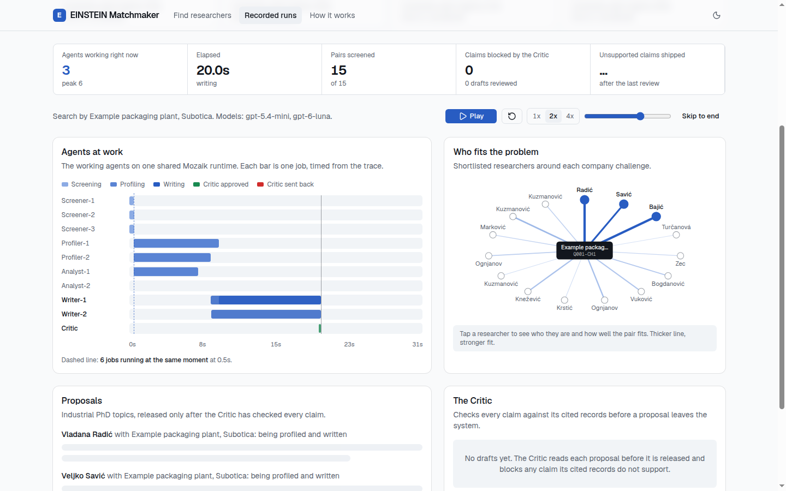

**How it works.** The architecture, inside the app.

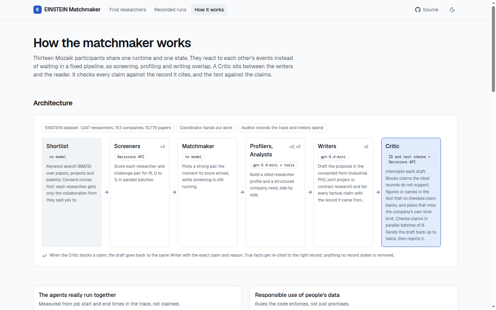

**The Critic evaluation**, including the bug it found and the one miss.

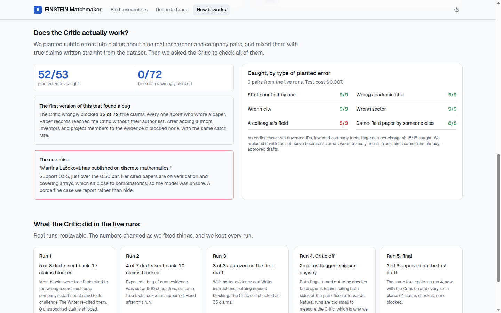

**On a phone, in dark mode.**

<p>
  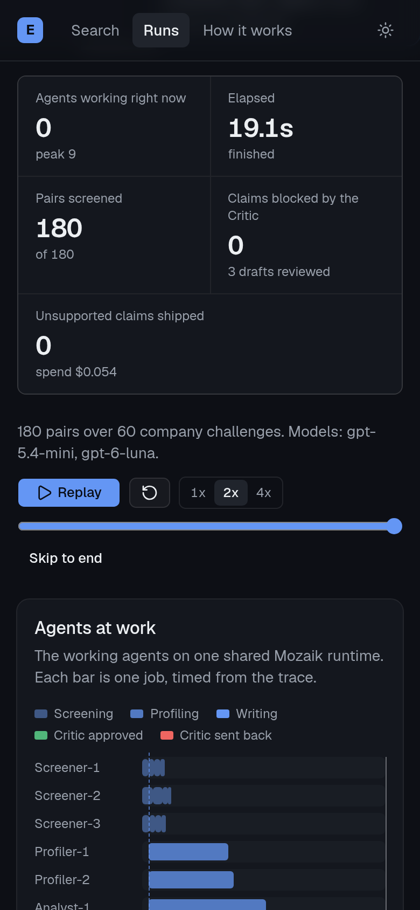
  &nbsp;
  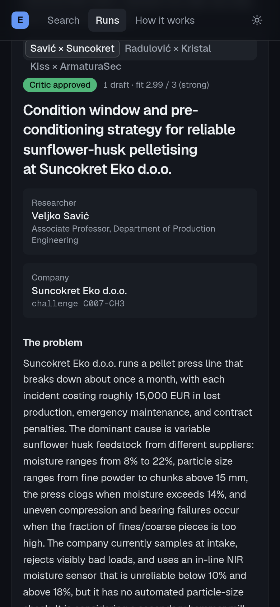
</p>

## What the brief asks for, and where it is

| Deliverable | Where |
| --- | --- |
| Architecture diagram | [Architecture](#architecture) below, and the **How it works** page in the web UI |
| Trace of one full run showing where the Critic stepped in | [`docs/evidence/run-01-live/trace.jsonl`](docs/evidence/run-01-live/trace.jsonl), walked through in [The Critic in a real run](#the-critic-in-a-real-run) |
| At least three proposals for three different pairs | [`docs/evidence/run-07-live/proposals.md`](docs/evidence/run-07-live/proposals.md). There are 21 batch proposals across seven live runs, plus 9 from Reverse Search |
| How it plugs into the EINSTEIN network and EINSTEIN Stars | [EINSTEIN network and EINSTEIN Stars](#einstein-network-and-einstein-stars) |
| What it does, architecture, how to run | This README |

## How to run

You need Node.js 20 or newer and git. Nothing below needs an API key unless it says **live**.

```bash
git clone https://github.com/jamilxt/einstein-matchmaker
cd einstein-matchmaker
npm ci
npm run setup:data        # clones jigjoy-ai/einstein-matchmaker-data next to the repo and links ./data
```

**Offline run (no key, no cost).** The full agent team runs on a deterministic stub model, with real dataset IDs, real concurrency, and the real Critic logic:

```bash
npm start                 # batch: 60 challenges, 180 pairs, 3 proposals
npm run start:nocritic    # same, with the Critic only recording what it would block (ablation)
npx tsx src/run.ts --input=examples/conveyor.json   # Reverse Search for one company problem
```

Proposals are in English by default, even for companies that write in Serbian. Add `--lang=sr` to any run for Serbian (Latin script).

Each run writes `runs/<id>/` with `trace.jsonl` (every event), `summary.json`, `timeline.txt`, `proposals.md` and `run.json`.

**Web UI (replays need no key):**

```bash
npm run serve             # http://127.0.0.1:8791
```

The UI is prebuilt in `public/`. To rebuild it: `cd web && npm ci && cd .. && npm run build:web`.

**Live run (real OpenAI APIs).** Live mode needs both the `--live` flag and `ALLOW_LIVE=1`, so nothing spends money by accident. `BUDGET_USD` is a stop threshold: before each model call starts, its estimated cost (input at list price plus a fixed output allowance) is reserved, and a call that would take spend plus reservations past the budget is refused and the run halts. Spend is then metered from the API-reported token usage. It is an estimate, not a guaranteed ceiling: Mozaik 4.2.0's OpenAI mapper does not pass `maxOutputTokens`, so one call's output is not capped by the API.

```bash
cp .env.example .env      # add OPENAI_API_KEY
ALLOW_LIVE=1 BUDGET_USD=0.50 npm start -- --live
ALLOW_LIVE=1 BUDGET_USD=0.10 npx tsx src/run.ts --live --input=examples/vinarija.json
ALLOW_LIVE=1 ALLOW_LIVE_SEARCH=1 npm run serve     # turns on the search form in the UI
```

To run the Critic evaluation: `ALLOW_LIVE=1 npm run eval:critic:hard -- --live`. It costs about $0.01. The guard tests run offline with no key: `npm run test:guards`.

**Check my numbers without a key.** `npm run verify:evidence` does not trust any `summary.json`. For every committed run it rebuilds the job intervals from the raw `trace.jsonl` and recomputes the peak jobs in flight, the overlap count, drafts, drafts sent back, claims blocked and spend, then compares them with the summary and with the evidence table below. It re-runs the ID-ownership check on every released batch proposal and the text check on runs 6 and 7, and it replays the Critic evaluation from the recorded scores ([replay](docs/evidence/critic-eval-hard/replay.md)). `npm run check` runs types, guard tests and this together; the same three run in CI on every push ([workflow](.github/workflows/checks.yml)). It proves the published numbers follow from the committed files. It cannot prove the traces came from a real API, since they are plain files.

## Architecture

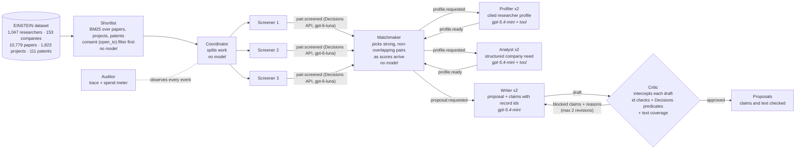

**Agent roles**

| Participant | Count | Model | Job |
| --- | --- | --- | --- |
| Coordinator | 1 | none | Splits the shortlist into batches and hands them to Screeners |
| Screener | 3 | OpenAI Decisions API (`gpt-6-luna`) | Scores each researcher and challenge pair for fit, 0 to 3, with a confidence |
| Matchmaker | 1 | none | Picks a strong pair the moment its score lands, keeps researchers and companies from repeating, and assigns Profiler, Analyst and Writer work |
| Profiler | 2 | `gpt-5.4-mini` + tool | Builds a researcher profile in which every expertise item cites the researcher's own records |
| Analyst | 2 | `gpt-5.4-mini` + tool | Turns the company record, challenge and web pages into a structured, cited need |
| Writer | 2 | `gpt-5.4-mini` | Writes the proposal in the form the researcher consented to, and lists every factual claim with the dataset ID that states it |
| Critic | 1 | ID and text checks + Decisions API | Intercepts the Writer's answer before it is committed. It checks each claim against its records and the text against the claims, then approves the draft or sends it back with each problem and the reason |
| Auditor | 1 | none | Writes every runtime event to `trace.jsonl` and meters spend per model |

**How they coordinate on Mozaik** ([`src/agents.ts`](src/agents.ts), [`src/jobs.ts`](src/jobs.ts), [`src/runtime.ts`](src/runtime.ts)):

- **Shared state, no direct calls.** All participants live on one runtime with a shared `MatchState`. They react to semantic events (`screen.batch`, `pair.screened`, `pair.selected`, `profile.requested`, `profile.ready`, `proposal.requested`, `critic.verdict`). Nobody calls anybody, and nothing waits for a whole stage to finish.
- **Early selection.** The Matchmaker doesn't wait for all 180 scores. In every live batch run it picked its first pair before screening ended (0.5 to 3.2 s in, with screening ending at 2.0 to 5.3 s), so profiling overlapped the rest of screening.
- **The Critic is an interception, not a later stage.** Each Writer job runs its loop with an `InterceptionHandler` on the model's final message. If a claim fails, or the text carries a figure or a name that no checked claim backs, the handler injects a correction listing the exact problems and reasons, and the same loop continues. True facts get re-cited to the right record, and anything no record states is removed. After 2 revisions an unfixable draft is rejected: it is recorded with the Critic's reasons, and neither the report nor the UI shows its text as a proposal.
- **One job, one fresh `ModelContext`.** Two live loops sharing one memory cross-contaminated in testing. Each job also gets a watchdog, because `runLoop` swallows failures ([mozaik#114](https://github.com/jigjoy-ai/mozaik/issues/114)), and a budget halt that ends the loop cleanly instead of redirecting to `idle` ([mozaik#113](https://github.com/jigjoy-ai/mozaik/issues/113)).

### Why the Decisions API, in results and cost

Two jobs in this system are judgements, not writing: "how well does this researcher fit this challenge, 0 to 3?" and "does this record support this claim, yes or no?". I send both to the OpenAI Decisions API (`gpt-6-luna`) and keep `gpt-5.4-mini` for the jobs that must write text (profiles, company needs, proposals).

**Cost.** Across all 10 live runs in `docs/evidence`, metered from API-reported token usage:

| | Decisions API | gpt-5.4-mini |
| --- | --- | --- |
| Requests | 137 | 152 |
| Input tokens read | 807,759 | 221,933 |
| Cost | **$0.081 (13% of spend)** | $0.556 (87% of spend) |

- The Decisions API did most of the reading (every pair to screen, every claim with its evidence) for an eighth of the bill. Its input costs $0.10 per million tokens and its output is free.
- The same 807,759 input tokens sent to `gpt-5.4-mini` would cost $0.61 for the input alone, 7.5 times more, before paying for any output. That is price arithmetic, not a run I did: I never built a chat-model screener to compare quality.
- The full hard Critic evaluation, 125 claims with their evidence, cost $0.007.

**Speed.** Three Screeners score all 180 shortlisted pairs in 2.0 to 5.3 s in the live runs. The Critic checked all 125 evaluation claims in 1.4 s. Fast screening is what lets the Matchmaker pick pairs early and start profiling while screening is still running.

**Results.** The answer comes back typed: a score on a fixed scale, or a probability that a claim is supported. Nothing has to be parsed out of free text, and no answer can drift into a paragraph. That gave us:

- **A threshold I can set and test.** The Critic blocks a claim when its support probability is below 0.5. That is what made the planted-error evaluation possible: 52 of 53 errors caught, 0 of 72 true claims wrongly blocked, and the one miss is visible as a number (0.55).
- **Scores the UI can show honestly.** A fit of 1.8 of 3 is shown as moderate, as in the winery search, instead of a model's confident prose.
- **Cheap red-teaming.** Because checks cost fractions of a cent, I could rerun the whole evaluation after each fix.

The limit: a decision model only judges, so the Critic explains a block with the claim, the cited record and the score, not a written argument. The Writer gets exactly that list when a draft is sent back.

## Evidence

All of it is committed under [`docs/evidence/`](docs/evidence) and can be replayed in the UI.

| Run | Critic | Peak jobs at once | Jobs overlapping | Drafts sent back | Claims blocked | Listed claims failing at release | Time | Cost |
| --- | --- | --- | --- | --- | --- | --- | --- | --- |
| [run-01-live](docs/evidence/run-01-live) | on | 9 | 21/21 | 5 of 8 | 17 | 0 | 32.6 s | $0.076 |
| [run-02-live](docs/evidence/run-02-live) | on | 9 | 21/21 | 4 of 7 | 10 | 0 | 36.6 s | $0.092 |
| [run-03-live](docs/evidence/run-03-live) | on | 9 | 21/21 | 0 of 3 | 0 | 0 | 19.1 s | $0.054 |
| [run-04-live-nocritic](docs/evidence/run-04-live-nocritic) | off | 9 | 21/21 | (would have: 1) | (flagged: 2) | 2 | 20.1 s | $0.056 |
| [run-05-live](docs/evidence/run-05-live) | on | 9 | 21/21 | 0 of 3 | 0 | 0 | 23.6 s | $0.062 |
| [run-06-live](docs/evidence/run-06-live) | on, with text check | 9 | 21/21 | 0 of 3 | 0 | 0 | 27.6 s | $0.065 |
| [run-07-live](docs/evidence/run-07-live) | on, with text check | 9 | 21/21 | 1 of 4 | 1 | 0 | 27.3 s | $0.077 |
| [run-08-live](docs/evidence/run-08-live) | on, with text check | 9 | 21/21 | 2 of 5 | 3 | 0 | 56.9 s | $0.098 |
| [search-01-packaging](docs/evidence/search-01-packaging) | on | 6 | 10/10 | 2 of 5 | 2 | 0 | 30.6 s | $0.063 |
| [search-02-winery](docs/evidence/search-02-winery) | on | 4 | 10/10 | 0 of 3 | 0 | 0 | 21.6 s | $0.034 |
| [search-03-serbian-input](docs/evidence/search-03-serbian-input) | on | 4 | 10/10 | 2 of 5 | 2 | 0 | 30.6 s | $0.060 |

What changed between runs, and why I kept every one:

- **Run 1:** most blocks were true facts cited to the wrong record, such as a company's staff count cited to its challenge text. The Writer re-cited them.
- **Run 2:** exposed a bug of mine. Evidence records were cut at 900 characters before the Critic read them, so some true facts looked unsupported. Fixed.
- **Run 3:** with complete evidence and clearer citation rules, all three proposals passed on the first draft. The Critic still checked all 35 claims.
- **Run 4 (Critic off):** both flagged claims turned out to be false alarms by the checker (claims that cite both sides of the pair, such as "supervised by X and Y"). Fixed afterwards.

- **Run 5 (final, all fixes):** all three proposals passed on the first draft, with 51 claims checked. The Matchmaker happened to pick the same three pairs as run 4, so runs 4 and 5 compare the same pairs with the Critic off and on. The fit scores (2.0 to 2.3) are lower than run 3's (2.9 to 3.0): the Matchmaker takes the first pair over its 2.0 threshold instead of waiting for all 180 scores. That is the price of early selection. The FinPuls proposal came out in Serbian because FinPuls wrote its challenge in Serbian. Proposals are now written in English by default; pass `--lang=sr` for Serbian (Latin script).

- **Run 6 (after the judge-style review):** the first run with the text check, consent-based forms and the new proposal sections. All three researchers had consented to industrial PhD supervision, so all three are PhDs (the consent change shows in the guard tests, not in this run). The Critic checked 60 claims and the text of all three drafts and approved each on the first draft. Fit scores were 2.86 to 3.00. The Matchmaker picked the same three pairs as run 1, so runs 1 and 6 show the same pairs before and after all the fixes: run 1 needed 8 drafts and 17 blocked claims to reach three approvals, run 6 needed 3 drafts and none. A CTO-style review caught one attribution error that the checks missed: the original run 6 draft joined Dragan Ilić to the chief-engineer title, although the records call him a senior PLC programmer. I corrected the displayed proposal and run summary to keep the chief engineer unnamed and identify Ilić only by the role the record states. The raw trace remains unchanged as historical evidence. I also tightened the Writer instruction; this role-attribution case still lacks a general deterministic role check.

- **Run 7 (after correcting the role-attribution slip):** reran the same batch with the tightened Writer instruction. It selected the same three pairs as run 6; the AutomVoj first step names Dragan Ilić without assigning him the chief-engineer title. The Critic checked 60 claims and all three live-generated proposal texts. One claim was sent back and corrected; all three proposals were approved, with 0 text problems and 0 unsupported claims in those generated finals. The run took 27.3 s and cost $0.07701. The live evidence is unchanged. A separate [human-reviewed proposal copy](docs/evidence/run-07-live/proposals-reviewed.md) makes offline feasibility and transparency edits; those edits were not re-run through the model Critic.

- **Run 8 (regression check after adding `verify:evidence`):** same three pairs as runs 6 and 7. The Critic checked 87 claims, sent 2 of 5 drafts back and blocked 3 claims; all three proposals were approved with 0 text problems and 0 unsupported claims. All 3 blocked claims were statements about the proposal itself ("the proposal form is an industrial PhD", "the proposal does not plan work before today"), which no dataset record states, so the Writer dropped them. The run took 56.9 s instead of about 27 s because one company-profiling call took 36 s; the Writers waited for it. It cost $0.09761. Two weaknesses that the human-reviewed run 7 copy fixed by hand still appear in the live text: the Kredo plan puts production deployment in year 3 although the company needs it within about six months, and the AutomVoj plan validates Siemens ladder logic in a Wago and Beckhoff lab without a compatibility step. The checks cover facts and citations, not plan feasibility.

The natural runs are too small to measure the Critic, which is why I tested it directly.

### The Critic, measured

[`src/eval-critic-hard.ts`](src/eval-critic-hard.ts) takes the 9 pairs from the live runs. For each pair it plants 6 kinds of subtle error into claims and writes 8 kinds of true claim straight from the dataset, so the Critic has never seen or approved them. Then it asks the Critic about all of them, concurrently.

| | Before fix ([v1](docs/evidence/critic-eval-hard-v1/results.md)) | After fix ([v2](docs/evidence/critic-eval-hard/results.md)) |
| --- | --- | --- |
| Planted errors caught | 52 / 53 | **52 / 53** |
| True claims wrongly blocked | 12 / 72 | **0 / 72** |

| Planted error | Caught |
| --- | --- |
| Staff count off by one | 9 / 9 |
| Wrong academic title | 9 / 9 |
| Wrong city | 9 / 9 |
| Wrong sector | 9 / 9 |
| A real paper by someone else in the same field | 8 / 8 |
| A colleague's neighbouring field | 8 / 9 |

- **The bug v1 found:** all 12 false blocks were true claims about who wrote a paper. Paper records reached the Critic without their author list. I now pass authors, project participants and patent inventors with every record.
- **The one miss:** "Martina Lačoková has published on discrete mathematics" scored 0.55 against a 0.50 bar. Her cited papers are on verification and covering arrays, which is close to combinatorics. It is a borderline case and a genuine miss.
- **Which layer does the work.** Replaying the recorded scores offline ([replay](docs/evidence/critic-eval-hard/replay.md)): the ID and ownership rules alone catch 8 of 53, all of them the paper by someone else; the support score catches 44 of the other 45. At every threshold tested, from 0.3 to 0.7, no true claim is blocked, and the one miss would be caught at 0.6. I kept 0.5, chosen before the evaluation, rather than tune the threshold to a 53-case test.
- **An earlier, easier set** (invented IDs, invented company facts, large number changes) scored 18/18 ([results](docs/evidence/critic-eval/results.md)). I replaced it because its errors were too easy and its true claims came from drafts the Critic had already approved.

### The Critic in a real run

From [`run-01-live/trace.jsonl`](docs/evidence/run-01-live/trace.jsonl), proposal for Veljko Pantelić (R0995) with AutomVoj (C003, challenge C003-CH2):

1. **16.1 s, draft 1: sent back, 6 claims blocked.** For example, "Veljko Pantelić is an Assistant Professor in Computing and Control Engineering" was cited to a paper (`SYN-PUB-10372`) that does not state his title (support 0). An expertise claim cited to five papers scored 0.29.
2. **Draft 2: sent back again** with the remaining failures.
3. **Draft 3: approved.** The broad expertise claim was split into five narrower ones, each citing the papers and project that state it (support 0.82 to 0.95). The Writer dropped the title claim instead of re-citing it to his researcher record. That was a true fact lost, and it is why the correction message now says: if a fact is true, cite the record that states it; delete it only if no record does.

Search the trace for `critic.verdict` to see every decision, or replay run 1 in the UI and watch the Critic lane.

### Guards added after a judge-style review

Before submitting, I reviewed the entry the way a judge would and found gaps that the planted-error evaluation could not show, because it only tests claims the Writer chose to list:

- **Facts in the text with no claim.** A draft whose problem section said a company "has 999999 employees and owns a nuclear reactor", with an empty claims list, was approved. Now [`src/verify/coverage.ts`](src/verify/coverage.ts) checks the text itself: every figure in a fact section must appear in a claim that the Critic verifies; every named person must appear in the pair's records; no other researcher or company may be named; planned work may not be dated in the past; and a draft needs claims about both sides.
- **Consent was too broad.** Anyone open to any collaboration got an industrial PhD proposal. Now the form follows the consent ([`src/data/consent.ts`](src/data/consent.ts)).
- **Rejected drafts were still shown**, labelled rejected. Now only the outcome and the Critic's reasons are.
- **The budget was checked after spending**, so concurrent calls could all start against the same headroom; a stalled job stopped being reviewed but kept running; two searches could start at once. All three are fixed (reservation before each call, the watchdog ends the loop, the search lock is taken before reading the request).
- **Proposals were weaker than their structure.** A plan was dated before today, staffing went beyond what a company offered, and novelty over the researcher's own papers was not stated. The Writer now gets today's date, the researcher's own paper titles and the consent wording, and must fill `novelty`, `data_status`, `to_agree` and a `pass_if` target per period.

`npm run test:guards` runs these attacks and controls offline, with no key:

| Guard | Result |
| --- | --- |
| Fabricated text with an empty claims list | blocked |
| Invented figure in the problem section | blocked |
| Invented person, and a researcher from outside the pair | both blocked |
| Plan dated in the past, including the real run 5 Pannonia draft ("ahead of the Q1 2026 filing") | blocked |
| 11 approved live proposals, as controls | 11 of 11 pass |
| PhD only with explicit PhD consent; Serbian and Cyrillic consent read | pass |
| Two calls that together exceed the budget; a non-numeric budget | second call refused; refused |
| A 300 ms watchdog on every job | loops end, nothing released |

14 of 14 pass. These are deterministic checks: they prove the guards fire on these cases, not that the Writer's prose is true in general.

### Proposals

From run 7 ([live-generated text](docs/evidence/run-07-live/proposals.md)). The live trace and Critic verdicts apply only to that generated version. I also provide a [human-reviewed copy](docs/evidence/run-07-live/proposals-reviewed.md) with a synthetic-data disclaimer and proposal-specific feasibility revisions; those post-run edits were not run through the model Critic. The UI labels proposals as illustrative and makes no commitment claims.

1. **Incremental PLC software product-line reuse for AutomVoj's 38 TIA Portal codebases.** Veljko Pantelić (R0995, Computing and Control Engineering) with AutomVoj (C003). The live run proposed reuse across the synthetic record's 38 codebases. The reviewed copy adds a Siemens-versus-Wago/Beckhoff validation gate and keeps changes offline until safety review, rollback planning, and written authorization.
2. **Contract-driven test generation for multi-supplier CAN integration at DriveLogic Vojvodina.** Martina Lačoková (R0919, Computing and Control Engineering) with DriveLogic (C018). The synthetic record describes CAN faults despite 87 to 89% branch coverage. The reviewed copy makes customer-artifact permissions and the €40,000 first-phase cap explicit, and defines novelty against SYN-PRJ-0434 as a measurable comparison rather than claiming contract-guided testing is new.
3. **Plain-language explanations for automated SME credit decisions at Kredo Fintech.** Branislav Žarković (R0801, Finance and Banking) with Kredo Fintech (C010). The reviewed copy sets a six-month bilingual prototype and evaluation gate; production use remains conditional on approved data access and compliance review.

The earlier showcase, run 3 ([full text](docs/evidence/run-03-live/proposals.md)), has stronger industrial detail in places (Suncokret Eko's moisture ranges and incident cost) but predates the fixes.

## Reverse Search

A company describes its problem in plain words. The text becomes a citable record (`Q001`, `Q001-CH1`), so every claim about the company still traces back to what the company actually wrote. The same team then runs on that one challenge: a 15-pair shortlist, three Screeners, profiles, writing and the Critic. The result is up to three researchers with a fit score, a reason and a full proposal each.

The three example problems in [`examples/`](examples) are test inputs written for this demo, not real companies. The bakery search ([`examples/pekara-sr.json`](examples/pekara-sr.json)) is written in Serbian. All three proposals came back in English, the default, with the problem's figures carried over (18,000 loaves a day, 4 to 6 percent scrap). The input's company label starts with "Primer", Serbian for "example", and the Writer read that as the company's name. The winery search is a useful honest case: the dataset has no strong wine-fermentation researcher, so the best fits are only moderate (about 1.8 of 3), and the UI labels them that way instead of overselling.

## EINSTEIN network and EINSTEIN Stars

EINSTEIN is a Horizon Europe Excellence Initiative (grant 101136377, 2024 to 2028) of nine institutions in Serbia, Austria, the Netherlands and Denmark, coordinated by the University of Novi Sad. NTP Novi Sad hosts its consortium meetings and the EINSTEIN Stars final. Its aim is to turn UNS into a hub for regional development and to connect research with business. EINSTEIN Stars is its competitive programme for UNS PhD students and young researchers whose work has strong industrial potential. The 2025 call received 8 applications.

**What exists today (built and tested here):**

- **A front door for NTP companies.** Reverse Search is a form an NTP company can fill in during or after an EINSTEIN event. Within about 30 seconds it returns researchers who fit, each with a proposal the company can read. The batch mode can scan every open challenge from NTP members at once.
- **Consent decides the collaboration form.** A researcher only gets an industrial PhD proposal if they said yes to supervising one; otherwise they get the joint project or contract research they agreed to (`open_to`). In the network this becomes a profile setting each researcher controls.
- **Proposals reviewers can verify.** Every claim cites a record, so an NTP innovation officer or a UNS tech-transfer officer can check a proposal in minutes before anyone is contacted.

**How it would plug in (proposed, not built):**

1. **Real data, same agents.** Swap the synthetic dataset for a UNS researcher registry, enriched from ORCID, OpenAlex, CORDIS and Lens (the APIs listed in the dataset's `docs/apis.md`). The agents read every record through `src/data/dataset.ts`, so that loader is where the change happens.
2. **A person approves before outreach.** An NTP or EINSTEIN coordinator approves each pair before the Writer runs or before anyone is emailed. The Critic's record makes that review quick.
3. **Partner universities as co-supervisors.** The same search over OpenAlex profiles at the consortium's partner universities (DTU, WUR, JKU) could suggest an international co-supervisor for each industrial PhD. That fits EINSTEIN's internationalisation goal.
4. **EINSTEIN Stars: an industrial partner for every pitch, and a wider funnel.**
   - **Each Stars applicant pitches with a company.** Run the matcher from their research outward, and they arrive at the pitch with a named NTP company, that company's own problem statement, and a cited first-step plan. A jury of industry and investors can judge that.
   - **More eligible researchers hear about the call.** Run it from company challenges inward: when a company problem matches an eligible PhD student's or recent PhD's work, the system can draft an invitation to apply.
   - **The jury still decides.** The system never scores or ranks applicants. It only proposes pairs and explains the fit.

## Responsible use of data

- **People are never ranked.** Only researcher and challenge pairs get a fit score, and the UI says so.
- **Consent decides the form, before any model sees a profile.** `open_to` is read in English, Serbian Latin and Serbian Cyrillic ([`src/data/consent.ts`](src/data/consent.ts)). An industrial PhD is only proposed to researchers who said yes to supervising one; researchers open only to joint projects or contract research get that form instead, and their own wording is passed to the Writer so conditions in it are respected. 25 researchers whose `open_to` lists none of these (for example consulting only) are excluded.
- **Every claim about a person or company must cite a dataset ID.** The Critic checks it against that record, and the record is one click away in the UI.
- **Only the official synthetic dataset is used.** Batch-run researcher and company records are fictional examples, not evidence that a real person or organization participated. A cited synthetic record verifies only what that record says; it does not establish real-world approval, consent, data access, staffing, or funding. The UI shows this notice on proposals. No real personal data is processed.
- **Cost is bounded.** Live runs need `--live` plus `ALLOW_LIVE=1` and stop at `BUDGET_USD` (an estimate-based threshold, see How to run). Live web search has per-search and total caps; a search that fails before reporting its spend is counted at its cap. Replays never call a model, and the public demo cannot start a search.
- **Search inputs are stored and replayable.** A Reverse Search keeps the company's problem text with its run, so the demo is for test inputs only, not confidential descriptions. A real deployment would keep runs private to the company that started them.
- **No secrets are stored in the repo.** The key lives in `.env`, which is git-ignored.

## Limitations

- On borderline topics the Critic can let a neighbouring-field claim through (1 of 53 planted errors).
- Natural Critic-on versus Critic-off runs are too small to show a difference, so the planted-error evaluation is the real measurement.
- Fit scores come from a model and are a starting point for a human conversation, not a decision.
- The text check finds figures and names, not every kind of fact. It checks figures only in the fact sections (targets in the plan are proposals), and it recognises people by first names that occur in the dataset, so a name from outside that list is not caught. A plain-language statement with no figure or name still relies on the Writer listing it as a claim.
- The budget reservation uses a fixed output allowance per call, so it is an estimate. A timed-out job stops its loop, but a request already in flight is not cancelled.
- Recorded runs 1 to 5 and the three searches predate the text check and the consent-based form. Run 3's water-testing proposal names Goran Radulović as a PhD supervisor, although his `open_to` lists joint projects and contract research, not PhD supervision; the current system writes him a joint project instead.
- Reverse Search shortlists by keywords first. A problem described in very different words from the researchers' papers can miss people, and the Decisions screening only reorders what the shortlist found.

## Timeline

All times are CET. The hackathon started on Friday 30 October at 10:00.

- **Before kickoff:** I read the Mozaik docs and chose the approach. While reading, I reported a mismatch in the docs ([mozaik#130](https://github.com/jigjoy-ai/mozaik/issues/130), 08:42), sent a fix that was merged ([mozaik-docs#2](https://github.com/jigjoy-ai/mozaik-docs/pull/2), 09:18), and proposed first-class support for decision models ([mozaik#131](https://github.com/jigjoy-ai/mozaik/issues/131), 09:44). The empty project on `@mozaik-ai/core` 4.2.0 was committed at 09:59:43, and the dataset was cloned at the same moment.
- **During the hackathon:** everything else.
  - The dataset loader and shortlist (10:01).
  - The first version of the agent team (10:26). It was written quickly with an AI coding assistant, and then reshaped by what the live runs showed.
  - Every Critic fix found in the live runs, and both Critic evaluations.
  - Reverse Search, the web UI and server, the deployment, and this README.

Every live run in [`docs/evidence`](docs/evidence) has a timestamped trace, and the commit history is public.

## Built with

- [`@mozaik-ai/core`](https://www.npmjs.com/package/@mozaik-ai/core) 4.2.0
- OpenAI `gpt-5.4-mini` and the Decisions API (`gpt-6-luna`)
- TypeScript on Node.js
- Web UI: React 19, Tailwind CSS 4 and shadcn/ui, served by a small Node server with no framework

Along the way I reported a documentation mismatch in Mozaik ([mozaik#130](https://github.com/jigjoy-ai/mozaik/issues/130), the `context_update` event renamed to `message_received`), fixed it in the docs ([mozaik-docs#2](https://github.com/jigjoy-ai/mozaik-docs/pull/2), merged), and proposed first-class support for decision models ([mozaik#131](https://github.com/jigjoy-ai/mozaik/issues/131)).

AI coding assistants were used while building this project.

## License

[MIT](LICENSE). The dataset belongs to its authors at [jigjoy-ai/einstein-matchmaker-data](https://github.com/jigjoy-ai/einstein-matchmaker-data).
